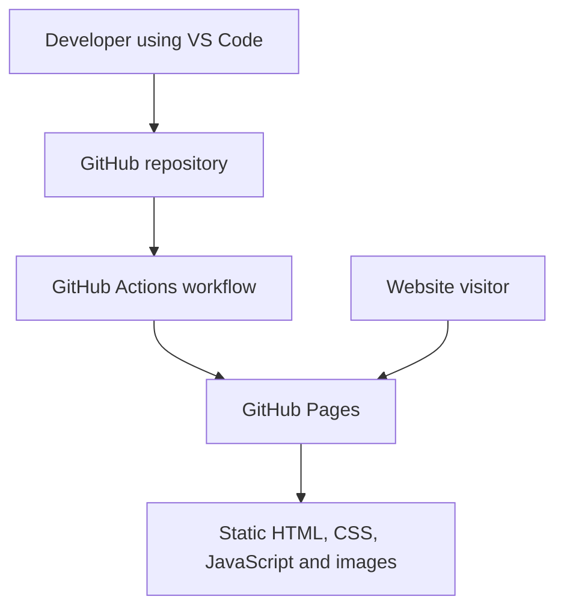
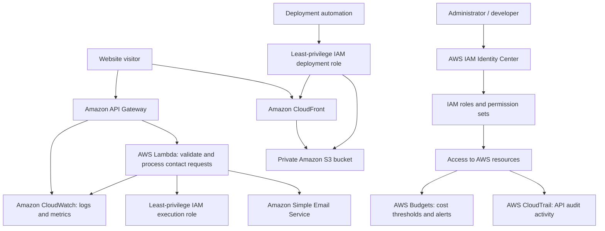

# MARA — Photography Portfolio & Cloud Engineering Project

**Live website:** [Explore MARA](https://maradubu.github.io/photography-portfolio-aws/)  
**Project status:** Photography website live on GitHub Pages · AWS infrastructure planned

MARA is an independent photography portfolio exploring architecture, geometry, colour, light and the overlooked details of everyday life. Both the photography and the website are original work, combining a personal visual practice with modern web development.

Beyond its creative purpose, MARA serves as a practical cloud engineering and cybersecurity project. Already live through GitHub Pages with automated deployment via GitHub Actions, the project provides a foundation for implementing secure AWS hosting, identity and access management, monitoring, and a serverless contact service.

The objective is to develop and document a complete, secure and maintainable cloud-hosted application through hands-on implementation.

## Website preview

Visit the [live website](https://maradubu.github.io/photography-portfolio-aws/).

> Screenshot coming soon: a cropped desktop view of MARA will be added here.

## Features implemented

- Responsive photography gallery with a full-screen lightbox
- Light and dark themes
- Optional, user-initiated ambient audio
- Contact interface with a honeypot field for basic bot detection; message delivery is **not yet enabled**
- Optimised WebP photography assets and a Python image-processing script
- Version-controlled source code and automated GitHub Pages deployment

## Current architecture



The workflow deploys the contents of `website/` whenever the configured deployment workflow runs following changes to the main branch.

## Proposed AWS architecture — not yet deployed



The diagram represents the **target design**, not services currently running in the AWS account. Public website traffic and administrative access are separate concerns. The exact implementation and permissions will be validated during deployment.

## Technology and services

| Technology or service | Purpose | Status |
| --- | --- | --- |
| HTML, CSS, JavaScript | Responsive website and interactions | Implemented |
| Python | Image optimisation and development tooling | Implemented |
| Git and GitHub | Source control | Implemented |
| GitHub Actions | Automated deployment | Implemented |
| GitHub Pages | Current static website hosting | Implemented |
| Amazon S3 | Private storage for static website assets | Planned |
| Amazon CloudFront | HTTPS content delivery and caching | Planned |
| AWS IAM | Least-privilege roles and policies | Planned |
| AWS IAM Identity Center | Centralised human access and permission sets | Planned |
| Amazon API Gateway | Public endpoint for contact requests | Planned |
| AWS Lambda | Server-side validation and contact processing | Planned |
| Amazon Simple Email Service (SES) | Email delivery | Planned |
| AWS CloudTrail | AWS API auditing | Planned |
| Amazon CloudWatch | Application logging, metrics and alarms | Planned |
| AWS Budgets | Spending thresholds and notifications | Planned |

## Security approach

| Risk | Control or decision | Status |
| --- | --- | --- |
| Accidental credential exposure | `.gitignore` excludes common secret and private-key file patterns; initial tracked-file and content checks completed | Initial checks completed |
| Automated contact-form spam | Hidden honeypot field in the browser | Implemented; server-side enforcement pending |
| Malicious or malformed contact submissions | Validate and constrain inputs in Lambda; add throttling and abuse controls | Planned |
| Unauthorised administrative access | IAM Identity Center, temporary role-based access and least-privilege permission sets | Planned |
| Excessive service permissions | Separate, narrowly scoped IAM roles for deployment and Lambda | Planned |
| Public access to origin files | Private S3 bucket accessed through CloudFront Origin Access Control | Planned |
| Limited visibility into activity | CloudTrail auditing and CloudWatch logging/alarms | Planned |
| Unexpected cloud spending | AWS Budgets alerts and careful resource selection | Planned |

**Security note:** The current browser-side honeypot is not a substitute for backend validation. Initial repository searches found no matches for selected common secret patterns, but they do not constitute a complete security audit or Git history scan.

## Run locally

Clone the repository and start a simple local web server:

```bash
 git clone https://github.com/Maradubu/photography-portfolio-aws.git
 cd photography-portfolio-aws/website
 python3 -m http.server 8000
```

Open [http://localhost:8000](http://localhost:8000) in your browser. Stop the server with `Ctrl+C`.

## Deployment

The current production website is deployed to **GitHub Pages** through `.github/workflows/deploy-pages.yml`. The workflow publishes the `website/` directory. Changes pushed to the deployment branch can trigger the workflow; deployment progress is visible under the repository's **Actions** tab.

AWS deployment is a future phase and will be documented separately once it has been tested.

## Roadmap

### Phase 1 — Functional website and delivery

- [x] Build responsive portfolio and image gallery
- [x] Add light/dark theme and optional ambient audio
- [x] Optimise photography assets
- [x] Deploy publicly using GitHub Pages
- [x] Configure GitHub Actions deployment
- [x] Add initial contact-form honeypot
- [x] Improve `.gitignore` and run initial secret-pattern checks

### Phase 2 — AWS hosting and governance

- [ ] Resolve AWS account access and confirm cost eligibility
- [ ] Configure IAM Identity Center and appropriate administrative access
- [ ] Define least-privilege IAM roles and policies
- [ ] Configure AWS Budgets before provisioning services
- [ ] Deploy website assets to a private S3 bucket
- [ ] Configure CloudFront with Origin Access Control and HTTPS
- [ ] Configure CloudTrail auditing and CloudWatch monitoring
- [ ] Test deployment, access controls, logging and recovery procedures

### Phase 3 — Secure contact service and automation

- [ ] Build an API Gateway and Lambda contact endpoint
- [ ] Implement server-side input validation, honeypot checks and abuse protection
- [ ] Configure SES for email delivery
- [ ] Restrict Lambda permissions to the required actions and resources
- [ ] Add automated tests and secure deployment checks
- [ ] Document security verification and operational lessons learned

## Costs

GitHub Pages currently hosts the website. The planned AWS version will be designed with cost awareness from the outset. AWS Budgets can notify on spending thresholds but **does not automatically prevent charges**. Resource pricing, account eligibility and any free-tier benefits must be checked before deployment.

## Project documentation

The [`docs/`](docs/) directory is intended for implementation notes, architecture decisions, troubleshooting, security verification and lessons learned.

A useful format for each technical milestone is:

1. **Objective:** What problem are we solving?
2. **Implementation:** What was configured or built?
3. **Explanation:** Why was this approach chosen?
4. **Verification:** How was the result tested?
5. **Troubleshooting:** What failed and how was it resolved?
6. **Lessons learned:** What would be improved next time?

---

**MARA** — An evolving intersection of photography, web development, cloud engineering and security.
